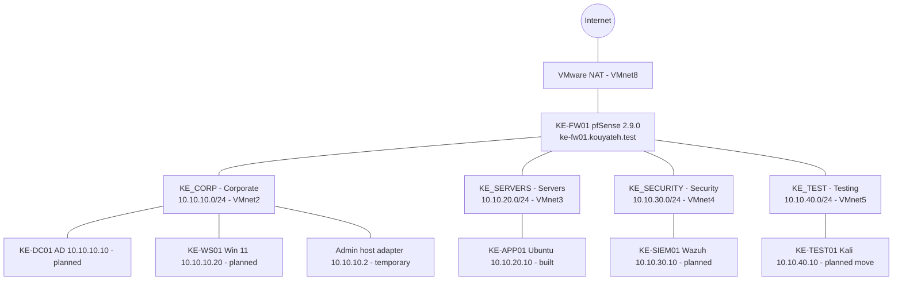

# Kouyateh Enterprises Cybersecurity Lab

I am building a small, segmented "enterprise" network at home to practice core security work: network segmentation, firewall policy, identity, monitoring, and controlled security testing. Kouyateh Enterprises is a fictional company. I document every step here, including what went wrong, so this repo shows my real progress.

## Goals

- Design and build a segmented network behind a pfSense firewall, using deny-by-default rules.
- Add identity (Active Directory), an endpoint, an application server, and a SIEM (Wazuh). *(planned)*
- Run a scoped assessment from an isolated Kali machine and use the results to improve the lab. *(planned)*
- Keep governance records the way a real team would: a risk register, an exceptions log, and a NIST control mapping.

## Status (as of 2026-10-25)

| Component | Role | Status |
|---|---|---|
| KE-FW01 (pfSense 2.9.0) | Firewall and router for all segments | Built; rules applied on all four segments; read-only tests passed |
| KE-APP01 (Ubuntu) | Application server, 10.10.20.10 | Built; moved to the Servers segment 2026-10-25; OpenSSH running |
| KE-TEST01 (Kali) | Assessment machine, 10.10.40.10 | VM exists but is still on VMware NAT (open risk R-01); move to VMnet5 planned |
| KE-DC01 (Windows Server, AD) | Domain controller, 10.10.10.10 | Planned |
| KE-WS01 (Windows 11) | Employee workstation, 10.10.10.20 | Planned |
| KE-SIEM01 (Wazuh) | SIEM, 10.10.30.10 | Planned |

## Architecture summary

Four internal segments sit behind one pfSense firewall. Each is its own VMware host-only network with no VMware DHCP or NAT. Only the firewall's WAN interface touches VMware NAT.

Details: [docs/architecture.md](docs/architecture.md)

## Lab environment

- Hypervisor: VMware Workstation on a Windows host
- Host: 32 logical CPUs, 63 GB RAM
- Firewall: pfSense 2.9.0

## Documentation

- [Architecture](docs/architecture.md)
- [Firewall rules](docs/firewall-rules.md)
- [Risk register](docs/risk-register.md)
- [NIST control mapping](docs/nist-control-mapping.md)
- [Test evidence](docs/test-evidence.md)
- [Lessons learned](docs/lessons-learned.md)

## What I have learned so far

- How to plan a segmented address space and map each segment to a virtual network and a firewall interface.
- How to write firewall rules that allow only what is needed, in the right order, ending with a logged default deny.
- Why a management path matters: I kept a dedicated admin adapter so I could not lock myself out while changing rules.
- That deny-by-default has real side effects (my server could not install packages), and how to handle that with a short, dated, documented exception.
- How to verify changes with tests instead of assuming they work, and to record what I have *not* tested yet.
- To snapshot before every change so I can roll back.

## How I work / how this lab came together

This lab is where I bring my ECPI University cybersecurity coursework together in one environment. Each class covered a different part of security on its own; here I connect those parts into a single working network. I build in stages. Most stages line up with a specific course; the rest are self-directed work where I am extending what I learned in class:

| Stage | Related coursework | Status in this lab |
|---|---|---|
| Segmented network and pfSense firewall policy | MSCS626 Network Security and Next-Gen Firewalls; MSCS635 Advanced Networking; CST160 Introduction to Networking; CYB200 Network Protocols and Services | Built and tested |
| Linux application server (KE-APP01) | CST200 Linux Administration; CST140 Introduction to Operating Systems | Built; hardening planned |
| Active Directory domain and Windows workstation | CYB240 Windows Client and Server; CST120 Computer Configuration I | Planned |
| Wazuh SIEM and log review | MSCS626 Network Security and Next-Gen Firewalls; MSCS525 Cybersecurity with Python | Planned |
| Isolated Kali assessment | Self-directed lab work | Planned |
| Risk register, exceptions log, NIST mapping | MSCS521 Security Architecture & Design; MSCS615 Cloud Security | Ongoing |

I am currently in the MS Cybersecurity, Cyber Operations program at ECPI University, where I hold a 4.00 GPA. Before starting the program, I completed prep coursework in networking, operating systems, and Linux and Windows administration. Next up are MSCS639 Cyber Forensics (Nov 2026) and MSCS637 Hardening Enterprise Security Architecture (Jan 2027), and I plan to bring what I learn in each into this lab.

I put the lab together little by little, using the same cycle for every piece:

1. **Plan** the design first: addressing, segments, and what each system should be allowed to reach.
2. **Build** one piece at a time, rather than changing several things at once.
3. **Snapshot** before each change, so I can roll back if something breaks.
4. **Verify** with evidence. I test from the admin host and record actual results, including what I have not tested yet.
5. **Document** the change, the test results, and any new risk before moving on.

When the secure design gets in the way of a task, I use a narrow, temporary exception that is dated, recorded, and removed as soon as the task is done. I made every firewall change by hand in the pfSense web interface.

## Roadmap

1. Move Kali to the Testing segment (VMnet5, 10.10.40.10) and verify isolation.
2. Build KE-SIEM01 (Wazuh) and enroll Wazuh agents on each host.
3. Build KE-DC01 (Active Directory) and KE-WS01 (Windows 11 with Sysmon).
4. Harden KE-APP01 and add a web service.
5. Enable and review firewall logs; decide on closing HTTP port 80 on the GUI.
6. Remove the temporary admin adapter on VMnet2.
7. Run a scoped Kali assessment, fix findings, and write it up.
8. Add restorable backups and a redacted configuration export.
